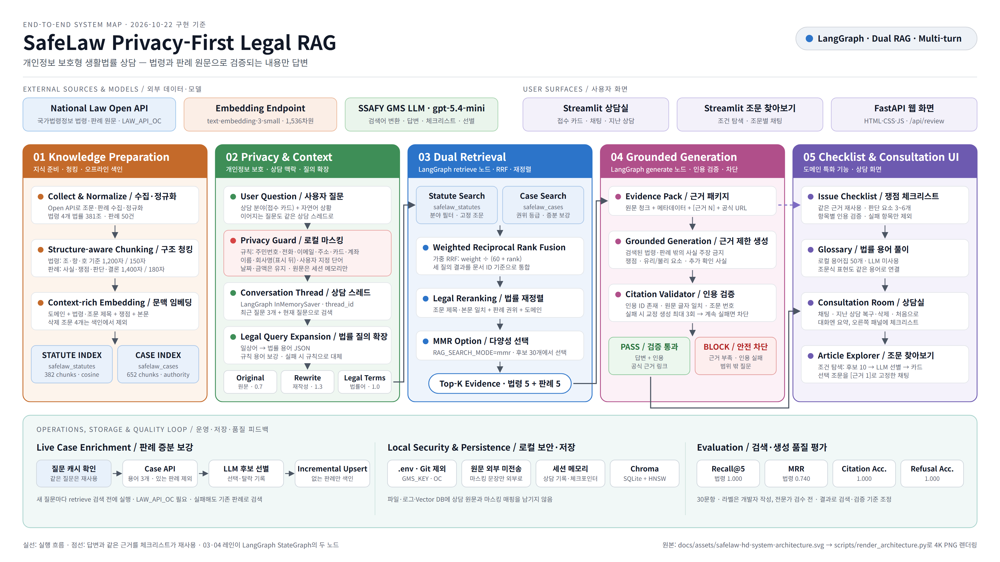
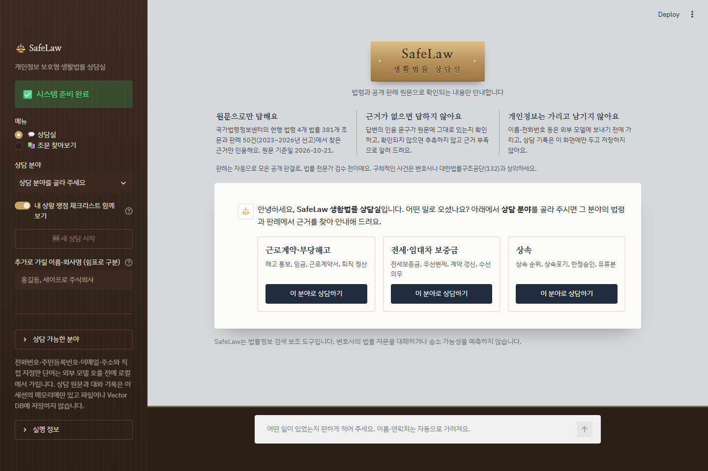
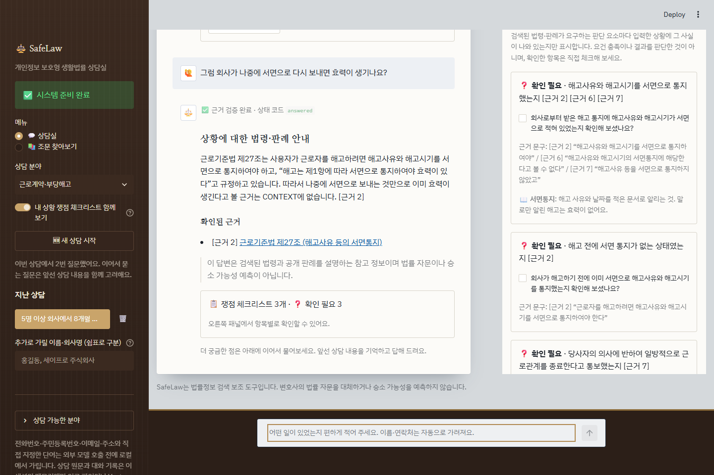
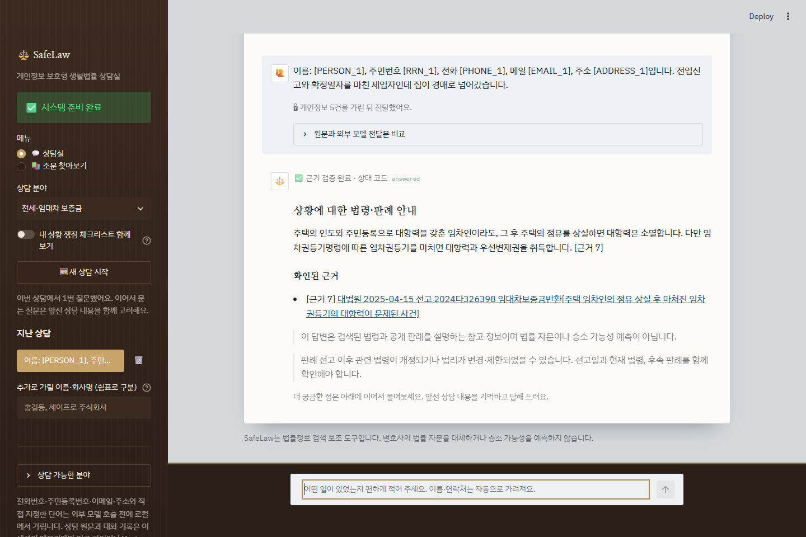

# SafeLaw

**개인정보 보호형 생활법률 판례 내비게이터**

사용자의 상황에서 개인정보를 먼저 비식별화하고, 관련 법령과 유사 판례를 찾아 판단 요소와 근거를 제시하는 RAG 서비스입니다.

## 범위

- 근로계약·부당해고
- 전세·임대차 보증금
- 상속

서비스는 승소·패소를 예측하거나 법률 자문을 제공하지 않습니다. 법령, 유사 판례, 유리·불리한 판단 요소와 추가로 확인할 사실을 근거와 함께 제시하는 것을 목표로 합니다.

## 현재 구현 단계

1. 프로젝트 공통 도메인 모델
2. LLM 호출 전 로컬 개인정보 마스킹
3. 보안 경계를 검증하는 자동화 테스트
4. 국가법령정보 현행법령 API 수집기
5. 3개 생활법률 도메인의 조문 단위 데이터셋
6. 조문 구조 기반 청킹과 GMS 임베딩·Chroma 색인 파이프라인
7. 자연어 검색어 확장·재정렬과 30문항 검색 평가셋
8. 검색 법령 한정 답변 생성과 인용·원문 문구 검증
9. 질문 입력·답변 상태·공식 근거 링크를 제공하는 Streamlit UI
10. 대법원 공개 판례 수집·정규화와 섹션 기반 청킹
11. 법령/판례 별도 Chroma 색인 및 통합 근거 답변
12. 데이터 출처·API 요청 규격·산출물·이용 조건 현황 문서
13. LangGraph `retrieve` → `generate` 노드 기반 RAG 파이프라인
14. 법령 조문 항목의 조건 기반 탐색 카드와 조문별 채팅
15. 판례 후보 선별 프롬프트, 청크·Top-k `.env` 설정, 내 상황 쟁점 체크리스트, MMR 검색, RAG 전후 비교
16. 이어지는 질문의 맥락을 기억하는 LangGraph 상담 스레드와 채팅형 생활법률 상담실 화면

## 제출 문서

| 문서 | 내용 |
|---|---|
| [요구사항 정의서](docs/requirements-definition.md) | 도메인 선택 조건 충족 근거, 기능·비기능 요구사항 표(F2001~F2016, NF2001~NF2007) |
| [RAG 파이프라인 설계문서](docs/rag-pipeline-design.md) | 컬렉션·메타데이터, 수집·청킹·색인, 병합·중복 제거, 프롬프트 3개, 청크·Top-k 선택 이유, 근거 표시, 특화 기능, 문제 해결 |
| [검증 결과](docs/verification-results.md) | 명세서 4장 항목별 실행 결과, 요구사항 대조표, 테스트 결과표, 응답 시간, 남은 항목 |
| [RAG 사용 전후 비교](docs/rag-before-after.md) | 심화 F2015 대표 질문 6개 비교 |
| [웹 화면·API](docs/web-api.md) | 심화 F2013 HTML/CSS/JS 화면과 요청·응답 형식 |
| [데이터 출처·이용 조건](docs/data-source-inventory.md) | API·수집 범위·건수·해시·이용 조건 |
| [제출 체크리스트](docs/submission-checklist.md) | 제출물과 점검 현황 |

### 필수·심화 기능 구분

| 구분 | 기능 |
|---|---|
| 필수 (F2001~F2012) | 법령 조문 메타데이터 색인(RAG 1), 검색어 추출(프롬프트1), 판례 후보 선별·수집(프롬프트2), 판례 색인(RAG 2), 근거 병합·중복 제거, LangGraph 근거 기반 답변(프롬프트3), 근거 표시, 조문 선택·채팅, 쟁점 체크리스트(특화), 조건 기반 조문 탐색, 진행 상태·면책 안내 |
| 심화 | F2013 HTML/CSS/JS 화면(FastAPI 분리), F2014 MMR 검색, F2015 RAG 전후 비교, F2016 법령·판례 출처 결합(부분) |

## 전체 시스템 아키텍처



원본은 4K(`3840×2160`) PNG로 저장되어 확대해도 각 단계와 연결 관계를 확인할 수 있습니다. 그림의 청크 수는 저장소 데이터로 재현되는 기준 색인(법령 `382`, 판례 `652`)이며, 질의 시 판례 증분 보강을 거친 로컬 색인은 이보다 클 수 있습니다. 세부 처리 규칙과 계층별 책임은 [`docs/architecture.md`](docs/architecture.md)에 정리했습니다.

## 프로젝트 구조

```text
ai-2_safelaw_gwangju_03_kimjinyoung/
├─ app.py                         # Streamlit 실행 진입점
├─ pyproject.toml                 # Python 패키지·테스트 설정
├─ docs/
│  ├─ architecture.md             # 시스템 경계와 데이터 흐름
│  ├─ search-quality.md           # 평가셋·Recall@5·MRR 결과
│  ├─ model-routing.md            # 단계별 모델 분리 기준
│  ├─ legal-retrieval-policy.md   # 법령·판례 검색 정책과 검수 항목
│  ├─ case-evaluation-label-audit.md # 판례 평가 라벨 자동 사전 감사
│  ├─ data-source-inventory.md    # 데이터 출처·API·모델·산출물 현황
│  └─ troubleshooting.md          # 검색 문제·원인·해결 기록
├─ src/legal_rag/
│  ├─ config.py                   # 환경변수·비밀값 설정
│  ├─ domain/                     # 순수 법률 도메인 모델
│  ├─ application/                # 사용자 요청 오케스트레이션
│  ├─ ports/                      # 외부 기술에 독립적인 인터페이스
│  ├─ collectors/                 # 법제처·대법원 공식 데이터 수집
│  ├─ rag/                        # 청킹·색인·검색·근거 검증·조문 항목 탐색
│  ├─ security/                   # 비식별화·출처 허용 정책
│  ├─ adapters/                   # Vector DB·GMS 구현체
│  └─ ui/                         # Streamlit 화면
├─ data/
│  ├─ statute_sources.json        # 수집 법령·카테고리·조문 범위 설정
│  ├─ case_sources.json           # 판례 본문 검색어·수집 상한 설정
│  ├─ raw/                        # 공식 원문(버전 관리 제외)
│  ├─ processed/                  # 정규화 조문 데이터셋·생성 명세
│  ├─ evaluation/                 # 검색 질문·정답과 Recall@5·MRR 결과
│  └─ indexes/                    # Vector DB 지속 데이터
├─ scripts/
│  ├─ build_statute_dataset.py    # API 수집·정규화·검증용 데이터 생성
│  ├─ build_statute_chunks.py     # 조문 구조 기반 청크 생성
│  ├─ build_statute_index.py      # GMS 임베딩·Chroma 색인
│  ├─ build_case_dataset.py       # 대법원 공개 판례 수집·정규화
│  ├─ build_case_chunks.py        # 판례 섹션 기반 청킹
│  ├─ build_case_index.py         # 별도 판례 Chroma 색인
│  ├─ search_statutes.py          # 자연어 검색어 확장·법령 검색
│  ├─ answer_statutes.py          # 근거 제한 답변 생성·검증
│  ├─ evaluate_statute_retrieval.py # 고정 평가셋 검색 품질 측정
│  ├─ evaluate_end_to_end_rag.py # 검색-생성-검증 전체 품질 측정
│  ├─ audit_case_evaluation_labels.py # 판례 평가 라벨·원문 링크 일관성 검사
│  ├─ inspect_chroma.py           # Chroma 문서·메타데이터 조회
│  ├─ show_rag_graph.py           # LangGraph retrieve/generate 구조 출력
│  ├─ show_evidence.py            # Top-k별 근거 목록 비교
│  ├─ capture_ui_screenshots.py   # README 제출용 UI 캡처 자동 생성
│  └─ generate_data_source_inventory.py # manifest 기반 제출용 현황 문서 생성
└─ tests/                          # 보안·도메인·RAG 검증
```

세부 시스템 흐름은 [`docs/architecture.md`](docs/architecture.md)에 정리했습니다.

## 실행 방법

Python 3.12 환경에서 프로젝트 의존성을 설치하고 `.env`에 `GMS_KEY`를 설정합니다. 법령 색인이 없다면 먼저 아래 색인 생성 단계까지 실행해야 합니다.

```powershell
python -m pip install -e .
streamlit run app.py
```

HTML/CSS/JS 화면(심화 F2013)은 FastAPI 서버로 실행합니다. 요청·응답 형식은 [`docs/web-api.md`](docs/web-api.md)에 있습니다.

```powershell
python -m pip install -e ".[web]"
uvicorn legal_rag.web.api:app --port 8000
```

Streamlit의 기본 주소는 `http://localhost:8501`, 웹 화면은 `http://localhost:8000`입니다. Streamlit은 왼쪽 메뉴에서 `💬 상담실`과 `📚 조문 찾아보기`를 고릅니다.

**💬 상담실** — 법률 상담소에서 상담하듯 대화가 아래로 쌓이고, 입력창은 화면 아래에 고정됩니다.
화면은 로펌 상담실처럼 꾸몄습니다. 사이드바는 호두나무 벽판, 입력창은 책상 위, 대화는 석회암 벽 앞에 놓인 상담 기록지에 쌓이고, 맨 위에는 황동 문패가 붙어 있습니다. 제목은 나눔명조, 본문은 IBM Plex Sans KR이며 테마는 `.streamlit/config.toml`, 장식은 `ui/streamlit_app.py`의 `_inject_styles`에 있습니다.
첫 질문 전에는 상담실이 지키는 세 가지 약속(원문으로만 답함, 근거가 없으면 답하지 않음, 개인정보는 가리고 남기지 않음)을 데이터셋 manifest의 실제 숫자와 함께 보여 주고, 판례가 법률 전문가 검수 전이라는 점과 대한법률구조공단(132)도 함께 알립니다. 상담 분야는 사이드바까지 가지 않고 상담실 안 세 장의 접수 카드에서 바로 고르며, 답변 뒤에는 이어서 물어보라는 안내가 붙습니다. 상담 중 `← 처음으로`를 누르면 분야 선택 화면으로 돌아가고, 진행 중이던 대화는 사이드바 지난 상담에 남습니다. 조문 찾아보기에는 `← 상담실로`, 조문 채팅에는 `← 다른 조문 고르기`가 있습니다.

- 왼쪽에서 상담 분야를 고르면 상담 안내와 자주 묻는 상황 예시가 나타나고, 예시를 누르면 바로 질문됩니다.
- **이어지는 질문**: 같은 상담 안에서 "그럼 회사가 나중에 서면으로 보내면요?"처럼 이어 물으면, LangGraph 체크포인터에 쌓인 앞선 질문(최근 3개)을 함께 붙여 검색하고 답합니다. `🆕 새 상담 시작`을 누르면 새 상담 스레드가 열립니다.
- **지난 상담**: 사이드바에 지난 상담이 최근 순으로 쌓입니다. 제목은 마스킹된 첫 질문입니다. 누르면 대화가 그대로 복구되고, 같은 `thread_id`로 이어서 물을 수 있습니다. 🗑️을 누르면 화면 기록과 체크포인터의 그 스레드가 함께 지워집니다. 기록은 브라우저 세션 메모리에만 있어 새로고침하면 사라집니다.
- 질문 말풍선에 가린 개인정보 건수가 표시되고, `원문과 외부 모델 전달문 비교`를 펼쳐 마스킹 결과를 확인할 수 있습니다. 추가로 가릴 이름·회사명은 왼쪽 메뉴에서 지정합니다.
- 답변 처리 중에는 "관련 법령과 판례를 찾고 근거 문구를 검증하고 있어요" 같은 진행 상태가 표시됩니다.
- 검증된 법령 기반 답변과 국가법령정보센터 원문 링크 확인
- 근거 부족·인용 실패·외부 호출 실패 시 안전한 차단 메시지 확인
- **도메인 특화 기능 — 내 상황 쟁점 체크리스트**: 답변과 같은 근거로 법령·판례가 요구하는 판단 요소를 3~6개 뽑고, 입력한 상황에 그 사실이 `✅ 상황에 나와 있음`·`⚠️ 상황과 다름`·`❓ 확인 필요` 중 어디에 해당하는지 표시합니다. 항목마다 사용자가 스스로 확인할 질문, `[근거 N]` 번호, 원문 인용 문구가 붙고, 확인한 항목을 체크하면 진행률이 표시됩니다. 대화 안 답변 아래에는 `📋 쟁점 체크리스트 4개 · ✅ 1 · ❓ 3` 같은 요약만 두고, 체크할 수 있는 전체 목록은 대화 오른쪽 패널에 고정해 스크롤해도 따라옵니다. 이전 답변의 요약에서 `오른쪽 패널에서 보기`를 누르면 그 답변의 체크리스트로 바뀝니다. 좁은 화면에서는 패널이 대화 아래로 내려갑니다. 항목에 `서면통지`·`대항력`·`한정승인` 같은 법률 용어가 나오면 그 항목 아래에 `📖` 쉬운 풀이가 붙습니다. 풀이는 LLM이 만들지 않고 `domain/glossary.py`에 미리 써 둔 50개 용어집에서 고르며, "서면으로 통지"처럼 조문식 표현도 같은 용어로 잡습니다. 같은 용어는 처음 나온 항목에서 한 번만 풉니다.

**📚 조문 찾아보기** — 법령 조문 하나를 서비스 항목으로 다룹니다.

- 조건 기반 조문 탐색: "해고할 때 회사가 지켜야 하는 통보 절차를 정한 조문"처럼 자연어 조건을 입력하면 법령 색인에서 후보 10개를 찾고, LLM이 조건에 직접 해당하는 조문만 골라 선정 이유와 함께 카드로 보여줍니다. LLM은 후보 번호만 반환하므로 후보 밖의 조문은 결과에 섞이지 않습니다.
- 조문 선택: 카드의 `이 조문으로 상담하기` 또는 분야별 전체 조문 목록에서 직접 고릅니다.
- 조문별 채팅: 선택한 조문의 청크는 질문마다 검색 순위와 관계없이 `[근거 1]`로 항상 포함됩니다. 질문은 외부 호출 전에 마스킹되며, 대화 기록은 조문별로 분리되어 현재 세션 메모리에만 보관됩니다.

## 전체 기능 화면



아래 화면은 모두 2026-10-22 최종 UI를 실제 Streamlit 서버(GMS 호출, 실제 색인)에서 1440×960으로 캡처한 것입니다. 입력한 개인정보는 모두 가상 값입니다.

### 상담실: 검색 근거로 검증된 법령·판례 답변


### 상담실: 앞선 상담을 이어받는 질문

두 번째 질문에는 해고 상황을 다시 적지 않았지만, 상담 스레드에 쌓인 첫 질문을 함께 검색해 같은 사건을 전제로 답합니다.



`← 처음으로`로 분야 선택 화면에 돌아간 뒤 사이드바 지난 상담에서 같은 상담을 다시 연 화면입니다. 목록 제목도 마스킹된 첫 질문으로 만들어집니다.



### 외부 호출 전 개인정보 마스킹 비교

아래 화면은 가상의 이름·주민등록번호·전화번호·이메일·주소가 각각 플레이스홀더로 치환된 결과를 한 장에서 비교합니다. 왼쪽 원문은 현재 브라우저와 로컬 Streamlit 세션 안에서만 보이고, 오른쪽 마스킹 문장만 검색·임베딩·LLM으로 전달됩니다. 원문과 치환 매핑은 파일·로그·Vector DB에 저장하지 않습니다.


### 법률과 무관한 질문의 안전한 답변 거부


### 내 상황 쟁점 체크리스트 (도메인 특화 기능)

대화 안에는 상태별 개수 요약만 두고, 체크할 수 있는 항목·근거 문구·`📖` 용어 풀이는 오른쪽 패널에 표시됩니다.


### 조건 기반 조문 탐색


### 조문별 채팅


화면 자료는 다음 명령으로 다시 생성할 수 있습니다. 로컬 Streamlit이 실행 중이어야 하며(기본 `8501`, `--url`로 변경) 실제 개인정보를 사용하지 않습니다. 전체 캡처는 답변·체크리스트·조건 탐색에 GMS를 약 10회 호출합니다. 웹 화면(`safelaw-web-frontend.png`)은 `--scenario web`으로 따로 만듭니다.

```powershell
.\.venv\Scripts\python.exe scripts\capture_ui_screenshots.py
# 조건 탐색·조문별 채팅 화면만 다시 생성
.\.venv\Scripts\python.exe scripts\capture_ui_screenshots.py --scenario article
```

## 법령 데이터셋

국가법령정보센터의 현행법령 검색 API와 본문 API를 사용합니다. 인증값 `OC`는 환경변수로만 읽으며 URL, 로그, 데이터셋에는 저장하지 않습니다.

현재 수집 범위는 다음과 같습니다.

- 근로계약·부당해고: 근로기준법, 기간제 및 단시간근로자 보호 등에 관한 법률
- 전세·임대차 보증금: 주택임대차보호법 전체, 민법 제303조~제318조 및 제618조~제654조
- 상속: 민법 제997조~제1118조

2026-10-21 생성본은 총 381개 조문입니다: 노동 158개, 임대차 96개, 상속 127개. 각 레코드에는 법령·조문 식별자, 시행일, 공포일, 소관부처, 원문 링크가 포함됩니다.

### 데이터셋 다시 만들기

PowerShell에서 발급받은 국가법령정보 공동활용 `OC`를 현재 프로세스에만 설정한 뒤 실행합니다.

```powershell
$env:LAW_API_OC="발급받은-OC"
python scripts/build_statute_dataset.py
Remove-Item Env:LAW_API_OC
```

결과물:

- `data/processed/statutes.json`: 조문 단위 정규화 데이터
- `data/processed/statutes_manifest.json`: 건수, 법령별 통계, 생성일, SHA-256

수집 대상과 조문 범위를 바꾸려면 `data/statute_sources.json`을 수정합니다. 법령 데이터는 수시로 개정될 수 있으므로 시연·검증 전 데이터셋을 다시 생성하고 manifest의 생성일과 해시를 기록합니다.

## 청킹과 임베딩

법령은 문맥이 조문·항·호·목 단위로 구성되므로 무조건 같은 글자 수로 자르지 않습니다. 먼저 API에서 보존한 줄 단위 구조를 묶고, 1,200자를 넘는 긴 조문만 최대 150자의 문맥 중첩을 두어 나눕니다. 임베딩 입력에는 본문과 함께 도메인, 법령명, 조문 번호·제목, 쟁점 태그를 넣습니다.

```powershell
# 1. 381개 조문을 청크 데이터셋으로 변환
python scripts/build_statute_chunks.py

# 2. 의존성 설치
python -m pip install -e .

# 3. .env에 GMS_KEY를 입력한 후 임베딩·Chroma 색인 생성
python scripts/build_statute_index.py
```

현재 기본 설정은 다음과 같습니다.

- 청크 최대 길이: 1,200자
- 청크 중첩: 최대 150자
- 임베딩 모델: `text-embedding-3-small`
- Vector Store: Chroma, cosine 거리
- 법령 색인 위치: `data/indexes/statutes/` — 재생성 가능한 산출물이므로 Git 제외

현재 데이터에서는 381개 조문 중 본문이 "제N조 삭제 <개정일>"뿐인 4개(근로기준법 제35조, 주택임대차보호법 제5조, 민법 제651조·제1002조)를 빼고 377개 조문이 382개 청크로 변환됩니다. 길이가 기준을 넘은 5개 조문만 각각 2개로 분할됩니다. 임베딩 모델을 변경하면 기존 벡터와 차원·의미 공간이 달라지므로 전체 색인을 다시 생성합니다.

### 청크·근거 수 설정

청크 크기, 중복 길이, 근거 수(Top-k)는 코드가 아니라 `.env`에서 바꿉니다. 값을 비우면 아래 기본값을 사용하고, 범위를 벗어나면 시작 시 오류를 냅니다.

| 환경변수 | 기본값 | 사용 위치 |
|---|---:|---|
| `STATUTE_CHUNK_SIZE` / `STATUTE_CHUNK_OVERLAP` | 1200 / 150 | `build_statute_chunks.py` |
| `CASE_CHUNK_SIZE` / `CASE_CHUNK_OVERLAP` | 1400 / 180 | `build_case_chunks.py`, 질문 시 판례 증분 색인 |
| `RAG_TOP_K` | 5 | Streamlit 상담실·조문 찾아보기, `answer_statutes.py`, `search_statutes.py`, `show_evidence.py` |
| `RAG_SEARCH_MODE` / `RAG_MMR_FETCH_K` / `RAG_MMR_LAMBDA` | similarity / 30 / 0.5 | Streamlit 답변 파이프라인의 법령·판례 검색 |

청크 설정을 바꾸면 청크 생성과 색인 스크립트를 다시 실행해야 검색에 반영됩니다. 스크립트의 `--max-chars`, `--overlap-chars`, `--top-k` 옵션은 `.env`보다 우선합니다. 평가 스크립트는 기준선 재현을 위해 기존 고정값을 유지합니다.

2026-10-22 같은 데이터셋으로 값만 바꿔 측정한 청크 수입니다.

| 문서 | 크기 / 중복 | 청크 수 |
|---|---|---:|
| 법령 377조문 | **1200 / 150 (기본)** | **382** |
| 법령 377조문 | 800 / 150 | 397 |
| 법령 377조문 | 500 / 100 | 432 |
| 법령 377조문 | 300 / 50 | 527 |
| 판례 50건 | **1400 / 180 (기본)** | **652** |
| 판례 50건 | 1400 / 0 | 630 |
| 판례 50건 | 1000 / 200 | 912 |
| 판례 50건 | 700 / 100 | 1265 |

법령은 대부분 조문이 1,200자보다 짧아 크기를 줄여도 청크 수가 완만하게 늘고, 판례는 본문이 길어 크기와 중복에 민감합니다. 조문 하나가 한 청크에 온전히 남는 1,200자를 법령 기본값으로 유지했습니다.

Top-k별 근거 목록은 답변을 생성하지 않고 확인할 수 있습니다. 판례 실시간 보강은 끈 상태로 실행합니다.

```powershell
python scripts/show_evidence.py "회사에서 카카오톡으로 내일부터 나오지 말라고 했어요" --category labor --top-k 1 3 5 8
```

같은 질문에서 Top-k 1은 법령 1건·판례 1건, 3은 3·3건, 5는 5·5건, 8은 법령 8건·판례 7건(중복 사건번호 제거)으로 근거가 늘었습니다. 해고 서면통지 조문(제27조)은 Top-k 3부터 근거에 들어왔고, Top-k 8에서는 제35조·제59조·제104조처럼 질문과 관련이 약한 조문도 함께 들어왔습니다. 검색어 변환 LLM의 출력이 실행마다 조금씩 달라 같은 Top-k에서도 순서는 바뀔 수 있습니다. 근거가 너무 적으면 핵심 조문을 놓치고, 너무 많으면 생성 모델에 관련 없는 근거가 섞이므로 기본값 5를 유지합니다.

### MMR 검색 (심화 F2014)

`RAG_SEARCH_MODE=mmr`이면 법령·판례 검색기가 후보를 `RAG_MMR_FETCH_K`(기본 30)개까지 넉넉히 모아 기존 RRF·법률어 재정렬을 마친 뒤, Maximal Marginal Relevance로 Top-k를 고릅니다. 관련성은 재정렬 점수를 후보 풀 안에서 0~1로 정규화한 값, 중복도는 Chroma에 저장된 청크 임베딩의 코사인 유사도이며 `RAG_MMR_LAMBDA`(기본 0.5)로 둘의 비중을 정합니다. 판례는 기존처럼 사건번호 중복을 먼저 제거한 풀에서 고릅니다.

검색어 변환을 한 번만 실행해 같은 검색 계획으로 두 방식을 비교합니다.

```powershell
python scripts/show_evidence.py "회사에서 카카오톡으로 내일부터 나오지 말라고 했어요" --category labor --top-k 5 --compare-search
```

2026-10-22 Top-k 5 비교 결과입니다.

| 질문 | 유사도 검색 | MMR(풀 30, λ 0.5) |
|---|---|---|
| 카카오톡 해고 통보 | 법령 5번째: 근로기준법 제104조(감독 기관에 대한 신고) | 제104조 대신 제76조의3(직장 내 괴롭힘 발생 시 조치). 판례 5건은 같고 순서만 바뀜 |
| 경매 시 보증금 우선변제 | 판례 5번째: 2025다213466 보증금 | 대신 2022다247378(파산 면책이 우선변제권 있는 보증금반환청구권에 미치는지) — 우선변제권의 다른 측면을 다룬 판례가 들어옴 |

두 질문 모두 상위 근거(제27조, 제3조의2·3조의3 등)는 그대로 유지되고, 끝 순위의 근거만 서로 다른 쟁점으로 바뀌었습니다. 이미 법률어 재정렬과 판례 사건번호 중복 제거가 적용돼 있어 차이가 크지 않으므로 기본값은 `similarity`로 두고, 근거가 한 쟁점에 몰리는 질문에서 `mmr`을 비교용으로 사용합니다. 법령은 같은 조문의 여러 청크가 한 근거로 합쳐지므로 Top-k 5에서도 근거가 3건만 나올 수 있습니다.

### Chroma DB 내용 확인

`data/indexes/statutes/chroma.sqlite3`과 `data/indexes/cases/chroma.sqlite3`은 일반 텍스트 파일이 아닙니다. VS Code의 SQLite 확장으로 내부 테이블을 볼 수는 있지만, HNSW 벡터 세그먼트는 사람이 직접 해석하거나 수정하는 대상이 아닙니다. 다음 명령으로 Chroma API를 통해 본문과 메타데이터를 안전하게 확인합니다.

```powershell
# 두 컬렉션의 전체 건수와 샘플 3건
.\.venv\Scripts\python.exe scripts\inspect_chroma.py

# 임대차 판례 5개만 확인
.\.venv\Scripts\python.exe scripts\inspect_chroma.py `
  --collection cases --category housing_lease --limit 5
```

기준 색인은 법령 `382`개, 판례 `652`개 벡터입니다. 판례 컬렉션은 질문 기반 API 보강으로 새 청크가 증분 추가되므로 로컬의 현재 건수는 더 클 수 있습니다. 정확한 현재 건수는 위 조회 명령으로 확인합니다. `data/indexes/`와 동적 캐시는 재생성 가능한 산출물이므로 Git에 올리지 않습니다.

역할별 채팅 모델 배치와 임베딩 모델 혼용 시 주의점은 [`docs/model-routing.md`](docs/model-routing.md)에 정리했습니다.
Chroma를 유지하고 Pinecone은 운영 확장 시 재검토하기로 한 근거는 [`docs/vector-store-decision.md`](docs/vector-store-decision.md)에 정리했습니다.

## 판례 데이터셋과 색인

국가법령정보 판례 목록·본문 API에서 데이터출처가 대법원인 공개 판례만 수집합니다. 판시사항·판결요지·참조조문에 설정한 핵심 검색어가 나타나는지 확인하고 동일 사건번호 중복을 제거합니다. 현재 생성본은 50건(노동 12, 임대차 27, 상속 11), 652개 청크입니다.

판례는 사건번호, 사건명, 사건종류, 법원, 선고일, 판결유형, 주문·결과, 판례 원문, 판결요지, 판시사항, 참조조문, 참조판례, 공식 원문 URL로 정규화합니다. 그 후 `법적 쟁점`, `법원의 판단`, `주문·결과`, `사실관계·판례 원문` 섹션을 분리하고 1,400자/180자 중첩 기준으로 청킹합니다.

또한 공식 API의 법원명과 판결유형을 이용해 `전원합의체 → 대법원 → 항소심 → 기타` 권위 등급을 저장합니다. 검색에서는 먼저 질문과 의미가 가까운 후보만 모은 뒤, 점수가 비슷한 후보 사이에서만 상급심·전원합의체 판례에 작은 가점을 줍니다. 따라서 유명하지만 질문과 무관한 판례가 관련 판례를 밀어내지 않습니다. 이 등급은 법적 구속력이나 승소 가능성을 뜻하지 않습니다.

질문 시 판례를 추가 수집할 때는 판례 목록의 사건명·법원·선고일만 LLM에 보여 주는 후보 선별 프롬프트(프롬프트2)로 본문을 받을 판례를 먼저 고릅니다. 후보마다 `indexed`·`rejected`·`filtered` 등 선택·탈락 결과를 수집 이력에 남기며, `scripts/enrich_case_index.py`로 한 질문의 결정 목록과 선별 이유를 확인할 수 있습니다. 세부 흐름은 [`docs/case-retrieval-evaluation.md`](docs/case-retrieval-evaluation.md#후보-선별-프롬프트)에 정리했습니다.

판결의 확정·상소 상태, 후속 판례에 의한 변경·제한, 선고 당시 법령 버전은 현재 API만으로 자동 확정하지 않습니다. 판례가 답변 근거로 사용되면 법령 개정과 후속 판례를 함께 확인해야 한다는 경고를 표시합니다. 세부 정책과 전문가 검수 항목은 [`docs/legal-retrieval-policy.md`](docs/legal-retrieval-policy.md)를 참고합니다.

```powershell
$env:LAW_API_OC="발급받은-OC"
python scripts/build_case_dataset.py
Remove-Item Env:LAW_API_OC
python scripts/build_case_chunks.py
python scripts/build_case_index.py
```

법령과 판례는 `data/indexes/statutes/`, `data/indexes/cases/`에 따로 저장합니다. 두 컬렉션은 독립적으로 검색하며 원시 유사도 점수를 직접 비교하지 않습니다. 최종 생성 컨텍스트에서 법령과 판례를 문서 유형으로 구분하고, 인용한 원문 문구가 실제 검색 근거에 존재할 때만 답변을 표시합니다.

## 자연어 법령 검색

사용자 질문은 로컬 개인정보 마스킹을 거친 후 검색어 확장 단계로 전달됩니다. 도메인 규칙과 GMS LLM이 일상 표현을 법률 용어로 바꾸고, 원문·재작성 질문은 가중 순위 결합에 사용합니다. 개별 법률 용어는 후보 조문을 넓게 수집하는 데 사용하며, 가장 강한 용어 신호와 조문 제목 일치도로 최종 순위를 보정합니다. 원문 질의를 함께 사용하므로 LLM이 부정확한 용어를 만들더라도 검색 신호가 하나로 고정되지 않습니다.

```powershell
python scripts/search_statutes.py `
  "회사에서 카카오톡으로 내일부터 나오지 말라고 했어요" `
  --category labor `
  --top-k 5
```

카테고리 값은 `labor`, `housing_lease`, `inheritance` 중 하나입니다. 현재 대표 질문 검증 결과와 한계는 [`docs/search-quality.md`](docs/search-quality.md)에 기록합니다.

## 검색 품질 평가

도메인별 자연어 질문 10개씩, 총 30개와 기대 법령·조문을 고정 평가셋으로 관리합니다. 각 질문의 Top-5 검색 결과로 `Recall@5`와 첫 정답 순위의 역수인 `MRR`을 계산합니다.

```powershell
# .env의 GMS_KEY와 data/indexes/statutes 색인이 필요
python scripts/evaluate_statute_retrieval.py
```

평가 산출물:

- `data/evaluation/statute_retrieval_cases.json`: 질문과 기대 조문
- `data/evaluation/statute_retrieval_results.json`: 질문별 Top-5와 최종 집계
- `data/evaluation/statute_retrieval_baseline.json`: 개선 전 기준선

현재 30문항 결과는 전체 `Recall@5 1.000`, `MRR 0.740`입니다(검색어 변환 `gpt-5.4-mini`, `data/evaluation/statute_retrieval_fast_query.json`). 검색어 변환에 `gpt-5-nano`를 쓰던 이전 결과는 `MRR 0.781`이었습니다. 이 수치는 자체 작성한 고정 평가셋에 대한 검색 성능이며, 실제 법률 판단의 정확도나 새로운 질문에 대한 일반화 성능을 뜻하지 않습니다.

RRF와 MRR의 계산 방식, 검색 품질이 악화됐던 시도와 해결 과정은 [`docs/troubleshooting.md`](docs/troubleshooting.md)에 정리했습니다. 판례 30문항의 사건번호 단위 평가, 기준 성능과 동적 API 보강 구조는 [`docs/case-retrieval-evaluation.md`](docs/case-retrieval-evaluation.md)에 기록합니다. 정답 라벨의 법률 검수 절차는 [`docs/case-evaluation-review-checklist.md`](docs/case-evaluation-review-checklist.md)를 따르며, 외부 검수자는 [`docs/case-evaluation-review-sheet.md`](docs/case-evaluation-review-sheet.md)에 결과를 기록합니다.

판례 평가셋은 제출 전 다음 명령으로 사전 감사합니다. 30개 문항·도메인별 10개 구성, ID 중복, 기대·허용 사건번호 존재 여부, 공식 원문 URL 및 카테고리 연결을 검사하고 JSON과 Markdown 보고서를 함께 갱신합니다.

```powershell
python scripts/audit_case_evaluation_labels.py
```

현재 자동 감사는 오류 `0건`으로 통과했습니다. 다만 이는 파일과 출처의 기계적 일관성 검사이며, 법률적 관련성·후속 판례·최신성에 대한 외부 전문가 승인을 대신하지 않습니다. 상세 결과와 사건별 공식 원문 링크는 [`docs/case-evaluation-label-audit.md`](docs/case-evaluation-label-audit.md)에서 확인합니다.

검색부터 답변 생성·인용 검증·답변 거부까지 연결한 30문항 평가는 [`docs/end-to-end-rag-evaluation.md`](docs/end-to-end-rag-evaluation.md)에 정리했습니다.

최종 End-to-End 평가는 답변 가능 24문항과 거부 대상 6문항으로 구성합니다. 현재 설정(검색어 변환 `gpt-5.4-mini`)에서 답변 성공률 `0.6667`, 인용 정확성 `1.0000`, 근거 없는 주장 차단률 `1.0000`, 답변 거부 정확성 `1.0000`을 기록했습니다. 검색어 변환에 `gpt-5-nano`를 쓰던 이전 결과는 답변 성공률 `0.7500`이었습니다. 차단된 문항은 모두 모델 문장을 노출하지 않았으며, 법률적 정답률이 아니라 개발자 작성 평가셋에 대한 시스템 지표입니다.

### 응답 시간과 검색어 변환 모델

검색어 변환을 `gpt-5-nano`로 하던 때는 질문 하나에 31.8~64.0초가 걸렸고, 그중 검색어 변환이 26~34초를 차지했습니다. 기본값을 `gpt-5.4-mini`로 바꾼 뒤 같은 조건(판례 실시간 보강·쟁점 체크리스트 포함)에서 8.3~16.7초로 줄었습니다. 대신 법령 MRR은 0.781 → 0.740, E2E 답변 성공률은 0.750 → 0.667로 조금 낮아졌습니다. 속도보다 검색 품질을 우선하려면 `.env`에 `GMS_QUERY_MODEL=gpt-5-nano`를 지정합니다.

## 근거 제한 답변 생성

검색과 생성은 LangGraph `StateGraph`의 `retrieve` → `generate` 두 노드로 구성합니다. 상담실은 같은 그래프를 체크포인터(`InMemorySaver`)와 함께 컴파일해 상담마다 `thread_id`를 두고, 상태의 `history`에 마스킹된 질문을 쌓아 다음 질문의 검색·생성에 최근 3개를 함께 붙입니다. `retrieve`는 법령·판례 근거 목록을, `generate`는 근거 제한 답변과 인용 검증 결과를 상태에 기록합니다. 노드별 입출력은 [`docs/architecture.md`](docs/architecture.md#langgraph-노드-구성)에 정리했고, 그래프 구조는 다음 명령으로 출력합니다.

```powershell
python scripts/show_rag_graph.py
```

검색된 법령을 CONTEXT로 전달하고 모든 주장에 근거 번호와 법령 원문의 인용문을 요구합니다. 생성 결과는 바로 표시하지 않고 다음 조건을 모두 검사합니다.

- 모든 주장에 하나 이상의 근거 번호가 있는가?
- 근거 번호가 실제 검색 결과에 존재하는가?
- 답변에서 언급한 조문 번호와 연결된 근거 조문이 일치하는가?
- 제출한 원문 인용문이 해당 검색 청크에 실제로 존재하는가?
- 출처가 국가법령정보센터의 HTTPS URL인가?

JSON 형식이나 근거 검증이 실패하면 응답을 폐기하고 실패 이유를 포함해 다시 생성합니다. 마지막 3차 시도는 가장 직접적인 근거 하나와 짧은 요약만 요구합니다. 3차 시도도 실패하면 모델 문장을 노출하지 않고 고정된 차단 메시지를 반환합니다.

```powershell
python scripts/answer_statutes.py `
  "회사에서 카카오톡으로 내일부터 나오지 말라고 했어요" `
  --category labor `
  --top-k 5
```

답변 상태는 `answered`, `no_evidence`, `insufficient_evidence`, `invalid_citations`, `generation_failed` 중 하나입니다. 법률과 무관한 질문은 검색 결과가 형식적으로 존재하더라도 `insufficient_evidence`로 답변하지 않습니다.

## 테스트

```powershell
python -m unittest discover -s tests -v
```

## 데이터 출처와 이용 시 주의사항

API별 요청 주소·파라미터·인증 환경변수, 실제 수집 범위, 현재 건수·해시, 모델, Git 제외 항목과 재현 명령은 [`docs/data-source-inventory.md`](docs/data-source-inventory.md)에 통합 정리했습니다.

- 출처: [국가법령정보 공동활용](https://open.law.go.kr/LSO/openApi/openApiManual.do)
- 검색 규격: 현행법령(시행일) 목록 조회 `target=eflaw`
- 본문 규격: 현행법령(시행일) 본문 조회 `target=eflaw`
- 서비스 공개 전 공동활용 신청 조건과 출처 표기 의무를 다시 확인합니다.
- 생성 데이터는 법률정보 검색 보조용이며 최신성·정확성을 보증하는 법률 자문이 아닙니다.
- 판례 목록·본문 규격: `target=prec`, 목록 본문검색 `search=2`

## 보안 원칙

- 원문 상담 내용은 Vector DB와 파일에 저장하지 않습니다.
- 마스킹은 검색·임베딩·LLM 호출보다 먼저 수행합니다.
- 마스킹 매핑은 현재 프로세스 메모리에서만 유지하고 로그에 남기지 않습니다.
- 법령·판례 저장소와 사용자 질문 저장소를 분리합니다.
- 공식 출처의 공개·비실명 문서만 색인합니다.
