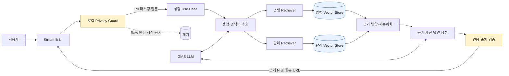
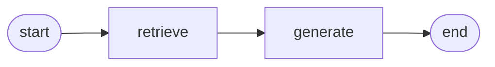
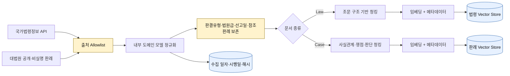

# 시스템 아키텍처


위 이미지는 오프라인 법령·판례 색인, 질의 시 개인정보 마스킹과 검색어 확장, 법령·판례 이중 검색, 근거 제한 생성·인용 검증, 최신 판례 증분 보강 및 평가 피드백을 한 화면에 정리한 4K 아키텍처다.

## 온라인 질문 처리



### 보안 경계

- 사용자 원문은 `Privacy Guard` 밖으로 나가지 않는다.
- 검색, 임베딩, LLM 호출에는 마스킹된 질문만 사용한다.
- 법령 Vector Store와 판례 Vector Store를 분리하여 검색 범위와 메타데이터를 독립적으로 관리한다.
- 답변에 사용된 근거 번호만 원문 URL과 함께 표시한다.
- 근거가 없거나 인용 검증에 실패하면 추측 답변을 출력하지 않는다.

### 검색어 확장과 순위 결합

1. 로컬 `Privacy Guard`가 원문 질문의 식별정보를 먼저 마스킹한다.
2. 도메인 규칙과 GMS LLM이 마스킹된 질문에서 법률 용어를 추출한다.
3. 원문 질문, 재작성 질문, 법률 용어 묶음을 동일한 모델로 각각 임베딩한다.
4. Chroma에서 선택한 도메인만 검색한다.
5. 원문·재작성 질문에는 가중 Reciprocal Rank Fusion을 적용하고 개별 법률 용어는 후보 수집에 사용한다.
6. 가장 강한 용어 점수와 조문 제목의 정확·부분 일치로 최종 순위를 보정한다.

LLM 검색어 확장이 실패하면 규칙 기반 검색어로 자동 폴백한다. 이 단계는 법률 결론을 생성하지 않고 검색 표현만 만든다.

### LangGraph 노드 구성

`StatuteRagPipeline`은 LangGraph `StateGraph`로 검색과 생성을 두 노드로 분리한다.



| 노드 | 입력 상태 | 출력 상태 | 책임 |
|---|---|---|---|
| `retrieve` | `question`, `category`, `top_k`, `pinned_hits` | `evidence`, `retrieved_count` | 마스킹된 질문으로 법령·판례 컬렉션을 검색하고, 선택 조문이 있으면 맨 앞에 고정한 뒤 `[근거 N]` 번호를 붙인 근거 목록을 만든다 |
| `generate` | `question`, `category`, `evidence` | `answer` | 근거가 없으면 `no_evidence`로 차단하고, 있으면 근거 제한 생성·인용 검증·최대 3회 교정을 수행한다 |

근거 없음도 `generate`에서 처리해 조건 분기 없이 두 노드의 직선 흐름을 유지한다.

상담실 채팅은 같은 그래프를 `InMemorySaver` 체크포인터와 함께 한 번 더 컴파일한 대화 그래프를 쓴다. 상담마다 `thread_id`를 두고, `history` 필드(리스트 합치기 리듀서)에 마스킹된 질문이 턴마다 쌓인다. `retrieve`는 최근 3개 질문을 `이전 상담 내용` + `현재 질문` 형태로 묶은 `contextual_question`으로 검색하고, `generate`도 같은 문장으로 답한 뒤 이번 질문을 `history`에 더한다. 체크포인트는 현재 프로세스 메모리에만 있고, 새 상담을 시작하면 새 `thread_id`를 쓴다. 사이드바의 지난 상담을 다시 열면 그 `thread_id`로 돌아가 맥락이 이어지고, 삭제하면 `forget_conversation`이 체크포인터의 해당 스레드를 지운다. 단발 질문용 그래프(`answer`)는 체크포인터 없이 동작해 평가 결과에 영향을 주지 않는다. 그래프 구조는 다음 명령으로 출력한다. 키와 색인이 없어도 실행된다.

```powershell
.\.venv\Scripts\python.exe scripts\show_rag_graph.py
```

### 도메인 특화 기능: 내 상황 쟁점 체크리스트

생활법률 상담에서 사용자가 가장 먼저 해야 할 일은 결론을 듣는 것이 아니라, 법이 무엇을 따지는지 알고 자기 사실관계를 확인하는 것이다. 그래서 승소 가능성 대신 **판단 요소별 확인 목록**을 특화 기능으로 정했다.

1. `pipeline.answer_with_evidence`가 답변과 함께 `retrieve` 노드의 근거 목록을 돌려준다. 체크리스트는 이 근거를 그대로 재사용해 검색을 다시 하지 않는다.
2. `IssueChecklistBuilder`가 근거와 마스킹된 상황을 받아 판단 요소 3~6개를 JSON으로 생성한다. 각 항목은 `status`(`mentioned`·`contradicted`·`unknown`), 확인 질문, 근거 번호, 원문 인용 문구를 가진다.
3. `status`는 상황 문장에 그 사실이 있는지만 나타낸다. 요건 충족이나 결과를 판단하지 않도록 프롬프트와 화면 문구에서 모두 제한한다.
4. 각 항목은 답변과 같은 인용 검증(`parse_grounded_claim`)을 거친다. 항목은 서로 독립적인 확인 질문이므로 검증에 실패한 항목만 빼고 나머지를 표시하며, 뺀 개수를 화면에 알린다. 검증된 항목이 하나도 없으면 한 번 다시 생성하고, 그래도 없으면 체크리스트를 표시하지 않는다.
5. 상담실에서는 답변 말풍선마다 체크리스트가 붙고, 대화 기록과 체크 상태는 세션 메모리에만 보관한다. 체크할 때마다 화면이 다시 그려져도 대화가 유지된다.

처음에는 항목 하나라도 인용이 틀리면 체크리스트 전체를 버렸다. 실제 모델로 같은 질문을 세 번 생성해 보니 한 번은 5개 중 1개 항목의 인용 문구가 원문과 달라 전체가 차단됐다. 항목 단위로 검증하도록 바꿔, 검증된 항목은 보여주면서 근거 없는 항목은 계속 막는다.

### 조문 항목 탐색과 조문별 상담

법령 조문 하나를 서비스 항목으로 다룬다. `StatuteCatalog`는 `data/processed/statute_chunks.json`을 조문 단위로 묶고, 각 청크를 Chroma 메타데이터와 같은 형태로 보관한다.

1. 사용자가 자연어 조건을 입력하면 로컬 마스킹 후 법령 색인에서 후보 10개를 검색한다.
2. 조문 선별 프롬프트가 후보를 `C1`~`Cn` 번호와 280자 요약으로만 보고 조건에 직접 해당하는 번호와 이유를 JSON으로 반환한다. 번호 밖의 값과 중복은 버리고, 응답을 해석할 수 없으면 결과를 표시하지 않는다.
3. 사용자가 카드나 전체 목록에서 조문을 고르면 그 조문 전용 채팅이 열린다.
4. 질문마다 선택 조문의 청크를 `pinned_hits`로 `retrieve` 노드에 넘긴다. `retrieve`는 고정 청크를 검색 결과보다 앞에 두고 같은 청크는 한 번만 사용하므로 선택 조문은 항상 `[근거 1]`이 된다.
5. 대화 기록은 `st.session_state`에 조문 ID별로 분리해 저장하고, 마스킹된 문장만 남긴다.

### 근거 제한 생성과 차단

1. 검색 청크 중 국가법령정보센터의 공식 HTTPS URL이 있는 조문만 생성 근거로 사용한다.
2. 중복 조문 청크를 하나의 `[근거 N]`으로 병합하고 질문과 함께 GMS에 전달한다.
3. LLM은 주장마다 근거 번호와 CONTEXT에서 그대로 복사한 법령 원문 문구를 JSON으로 반환한다.
4. 애플리케이션은 근거 번호, 조문 번호, 원문 문구 포함 여부를 결정적으로 검증한다.
5. 검증된 주장만 코드가 Markdown으로 렌더링하고 공식 원문 URL을 붙인다. LLM이 만든 URL은 허용하지 않는다.
6. 검색 근거 없음, 근거 부족, 잘못된 인용, 생성 실패 시 LLM 답변을 폐기하고 고정된 안전 메시지를 반환한다.

JSON 형식 또는 인용 검증 실패 시 실패 이유를 붙여 동일한 근거로 재생성하며, 마지막 3차 시도는 가장 직접적인 근거 하나와 요약만 요구한다. 세 번 모두 실패하면 `invalid_citations`로 차단한다. 이 검증은 인용문이 실제 근거에 존재하는지는 확인하지만 법률 해석의 타당성 전체를 자동 보증하지는 않는다.

## 오프라인 데이터 수집·색인



## 계층 책임

| 계층 | 책임 | 의존 규칙 |
|---|---|---|
| `domain` | 법령·판례·질문 모델과 규칙 | 외부 라이브러리에 의존하지 않음 |
| `application` | 마스킹 → 검색 → 생성 → 검증 순서 제어 | `ports`에만 의존 |
| `ports` | 수집기·검색기·LLM 계약 | 구현 기술을 모름 |
| `collectors` | 공식 API 호출과 응답 변환 | `domain`, `ports` 계약 구현 |
| `rag` | 청킹, 색인, 검색, 근거 병합·검증 | 도메인 규칙과 저장소 계약 사용 |
| `adapters` | Chroma·GMS 등 교체 가능한 기술 | `ports` 계약 구현 |
| `ui` | 입력·진행 표시·근거 렌더링 | `application`만 호출 |

판례 관련성·권위·시간 정보와 자동 판단 금지 항목은 [`legal-retrieval-policy.md`](legal-retrieval-policy.md)에 정리한다.

