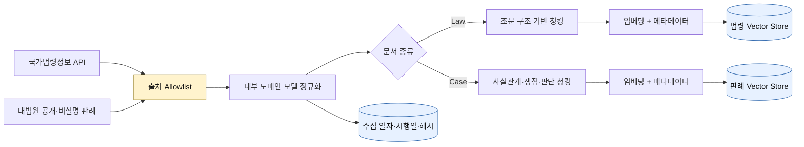

# 시스템 아키텍처

## 온라인 질문 처리

```mermaid
flowchart LR
    U[사용자] --> UI[Streamlit UI]
    UI --> PG[로컬 Privacy Guard]
    PG -->|PII 마스킹 질문| APP[상담 Use Case]
    PG -.->|Raw 원문 저장 금지| DROP[(폐기)]

    APP --> QE[쟁점·검색어 추출]
    QE --> SR[법령 Retriever]
    QE --> CR[판례 Retriever]
    SR --> SV[(법령 Vector Store)]
    CR --> CV[(판례 Vector Store)]
    SV --> MERGE[근거 병합·재순위화]
    CV --> MERGE
    MERGE --> GEN[근거 제한 답변 생성]
    GEN --> VERIFY[인용·출처 검증]
    VERIFY -->|[\uadfc거 N] 및 원문 URL| UI

    LLM[GMS LLM] <--> QE
    LLM <--> GEN

    classDef security fill:#fff3cd,stroke:#8a6d00,color:#111;
    classDef store fill:#e7f1ff,stroke:#225ea8,color:#111;
    class PG,VERIFY security;
    class SV,CV store;
```

### 보안 경계

- 사용자 원문은 `Privacy Guard` 밖으로 나가지 않는다.
- 검색, 임베딩, LLM 호출에는 마스킹된 질문만 사용한다.
- 법령 Vector Store와 판례 Vector Store를 분리하여 검색 범위와 메타데이터를 독립적으로 관리한다.
- 답변에 사용된 근거 번호만 원문 URL과 함께 표시한다.
- 근거가 없거나 인용 검증에 실패하면 추측 답변을 출력하지 않는다.

### 검색어 확장과 순위 결합

1. 로컬 `Privacy Guard`가 원문 질문의 식별정보를 먼저 마스킹한다.
2. 도메인 규칙과 GMS LLM이 마스킹된 질문에서 법률 용어를 추출한다.
3. 원문 질문, 재작성 질문, 법률 용어 묶음을 동일한 모델로 각각 임베딩한다.
4. Chroma에서 선택한 도메인만 검색하고, 결과를 가중 Reciprocal Rank Fusion으로 병합한다.
5. 조문 제목에 추출 용어가 직접 포함되면 작은 어휘 일치 가산점을 적용한다.

LLM 검색어 확장이 실패하면 규칙 기반 검색어로 자동 폴백한다. 이 단계는 법률 결론을 생성하지 않고 검색 표현만 만든다.

## 오프라인 데이터 수집·색인



## 계층 책임

| 계층 | 책임 | 의존 규칙 |
|---|---|---|
| `domain` | 법령·판례·질문 모델과 규칙 | 외부 라이브러리에 의존하지 않음 |
| `application` | 마스킹 → 검색 → 생성 → 검증 순서 제어 | `ports`에만 의존 |
| `ports` | 수집기·검색기·LLM 계약 | 구현 기술을 모름 |
| `collectors` | 공식 API 호출과 응답 변환 | `domain`, `ports` 계약 구현 |
| `rag` | 청킹, 색인, 검색, 근거 병합·검증 | 도메인 규칙과 저장소 계약 사용 |
| `adapters` | Chroma·GMS 등 교체 가능한 기술 | `ports` 계약 구현 |
| `ui` | 입력·진행 표시·근거 렌더링 | `application`만 호출 |

