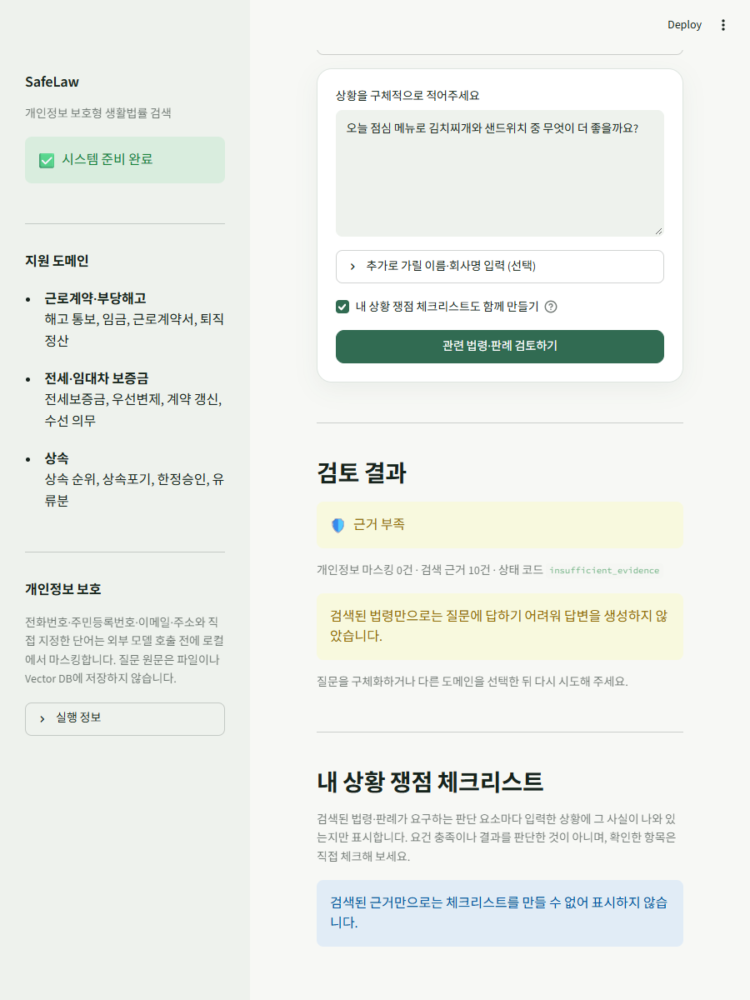
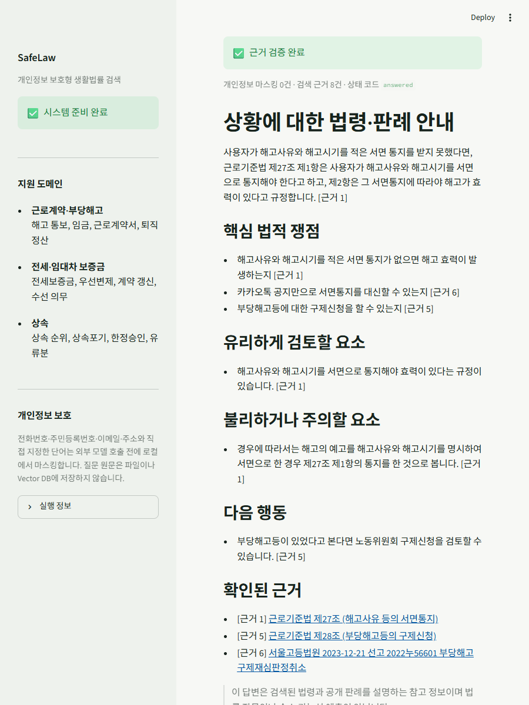
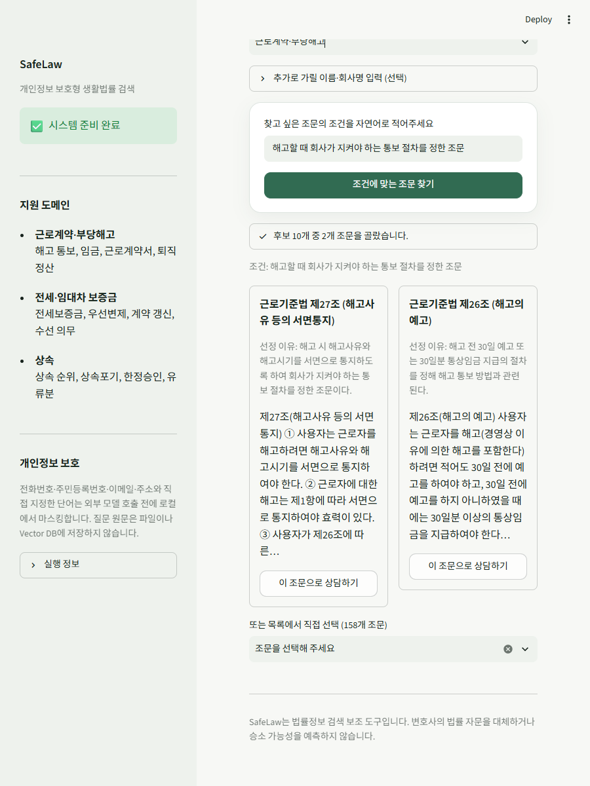
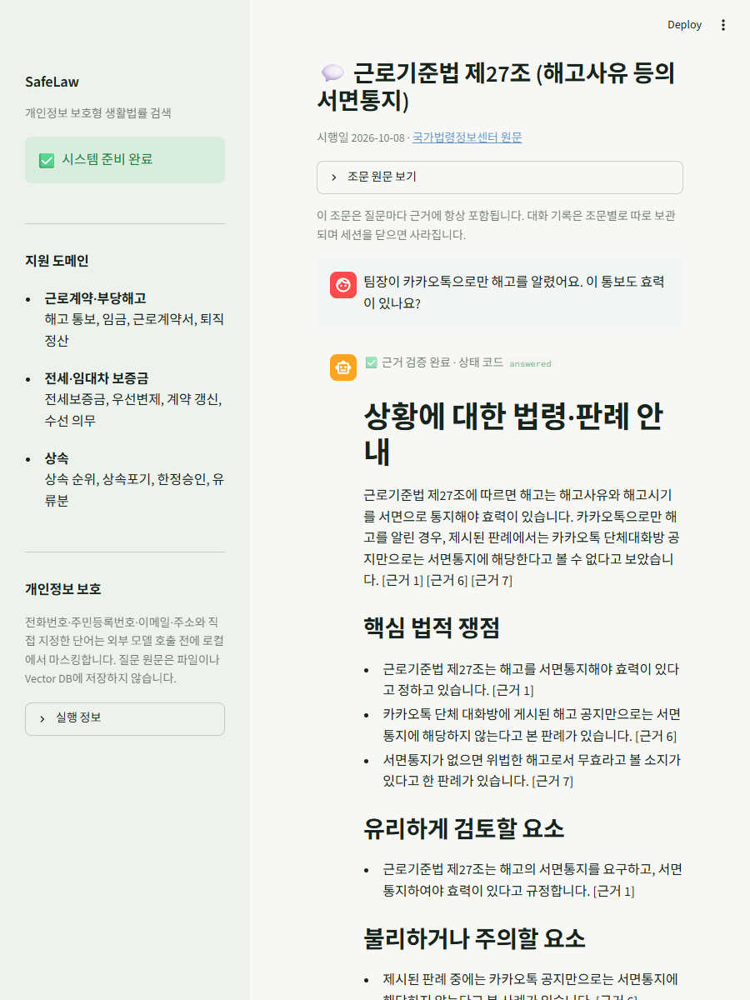
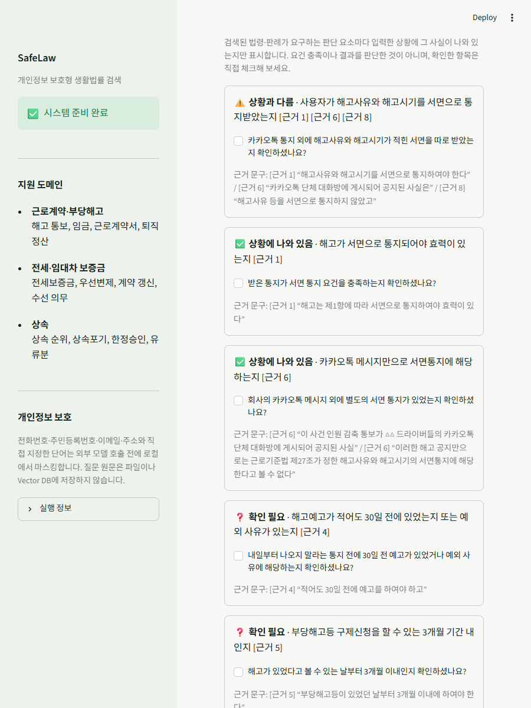
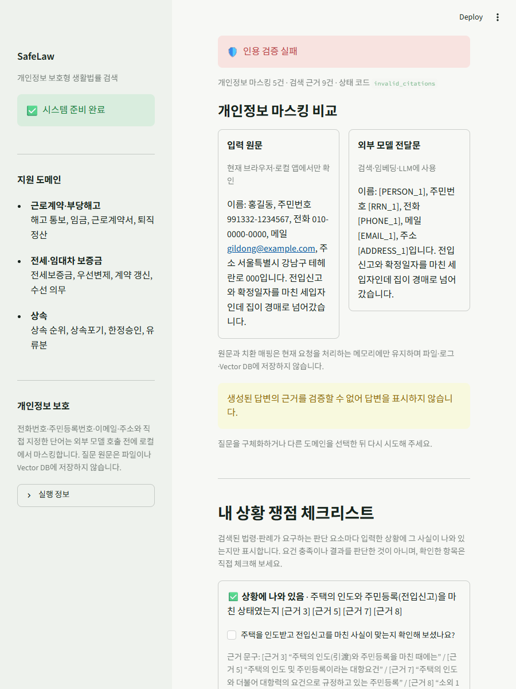

# 검증 결과 — SafeLaw

명세서 4장의 확인 항목을 실행 결과로 기록한다. 결과는 `통과`·`부분`·`실패`·`미확인`·`미구현`으로 표시한다. 기준일 2026-10-22, 로컬 Streamlit(8502)과 레포 `.venv`(Python 3.12)에서 확인했다.

## 1. 요약

| 구분 | 결과 |
|---|---|
| 필수 기능 F2001~F2012 | 12개 모두 통과 |
| 심화 기능 | F2014 MMR 통과, F2015 RAG 전후 비교 통과, F2016 부분, F2013 미구현 |
| 비기능 NF2001~NF2007 | 6개 통과, NF2001 응답 시간 부분 |
| 자동 테스트 | 125개 통과 |
| 남은 항목 | [7장](#7-남은-항목) 참고 |

## 2. 확인 항목별 결과 (명세서 4.1~4.7)

### 4.1 데이터와 색인 (F2001~F2002)

| 확인 항목 | 결과 | 증빙 |
|---|---|---|
| 로드한 항목 수와 색인 청크 수 | 통과 | 조문 381건 → 청크 386개, 실제 법령 Chroma 386건. 1,200자를 넘는 5개 조문만 2개로 나뉘어 차이 5 |
| 색인을 두 번 실행해도 청크 수가 늘지 않음 | 통과 | 같은 386개 청크를 새 Chroma에 두 번 upsert → 1회 386, 2회 386 (청크 ID 고정) |
| 항목 1건의 색인 텍스트에 의도한 속성 포함 | 통과 | `labor:001872:0027001:000` = 도메인·법령명·조문 번호·제목·쟁점 태그·본문 ([설계문서 2.1](rag-pipeline-design.md#21-safelaw_statutes--항목-메타데이터-rag-1)) |

### 4.2 문서 수집과 색인 (F2003~F2005)

| 확인 항목 | 결과 | 증빙 |
|---|---|---|
| 프롬프트1이 뽑은 검색어 목록 | 통과 | 카카오톡 해고 질문 → `해고, 해고 통보, 서면통지, 해고사유, 해고시기, 해고 효력, 근로계약 해지, 부당해고` (`show_evidence.py --compare-search` 출력) |
| 프롬프트2에 따라 색인된 문서와 버려진 문서 구분 | 통과 | 임대차 갱신 거절 질문: 목록 후보 8건 중 2023다307024만 `indexed`, 양도소득세·가맹사업 등 7건 `rejected` (`enrich_case_index.py` 출력, [case-retrieval-evaluation.md](case-retrieval-evaluation.md#후보-선별-프롬프트)) |
| 같은 질문을 다시 물으면 수집이 일어나지 않음 | 통과 | 같은 질문 재실행 → `cache_hit: true`, 같은 결정 목록 반환 |
| 선택한 항목 자체를 다룬 문서가 빠지지 않음 | 통과 | 조문별 채팅에서 선택 조문이 항상 `[근거 1]` (단위 테스트 `test_pinned_article_is_always_first_evidence`, 화면 확인) |
| 청크 크기·중복 길이를 바꾸면 청크 수가 달라짐 | 통과 | 법령 1200/150 → 386, 800/150 → 401, 500/100 → 436, 300/50 → 531. 판례 1400/180 → 652, 1000/200 → 912, 700/100 → 1265 (`.env` 값만 변경) |

### 4.3 답변과 근거 (F2006~F2008)

| 확인 항목 | 결과 | 증빙 |
|---|---|---|
| Top-k를 바꾸면 근거 목록이 달라짐 | 통과 | Top-k 1 → 법령 1·판례 1, 3 → 3·3, 5 → 5·5, 8 → 8·7 (`show_evidence.py --top-k 1 3 5 8`) |
| LangGraph가 retrieve·generate 두 노드 | 통과 | `show_rag_graph.py` → `nodes: retrieve, generate` / `__start__ -> retrieve -> generate -> __end__` |
| 답변의 근거 번호와 화면 근거 목록 일치 | 통과 | 인용된 근거만 `확인된 근거`에 표시. 존재하지 않는 번호·원문에 없는 인용은 코드가 차단 (`test_citations`, `test_pipeline`) |
| 항목 메타데이터와 외부 문서 구분 | 통과 | 근거 링크를 `법령 근거` / `유사 판례`로 나눠 표시, CONTEXT에 `document_type` 구분 |
| 문서에 없는 것을 물으면 확인되지 않는다고 답함 | 통과 | "근로기준법 제200조는?" → `insufficient_evidence`, 점심 메뉴 질문 → 근거 부족 화면 () |
| 인용된 근거가 없을 때 안내 | 통과 | 인용 없는 주장은 검증에서 실패 → 재생성 → 3회 실패 시 `invalid_citations` 안내. E2E 30문항에서 검증되지 않은 답변 노출 0건 |

### 4.4 서비스 기능과 화면 (F2009~F2012)

| 확인 항목 | 결과 | 증빙 |
|---|---|---|
| 항목을 바꿔도 이전 대화가 섞이지 않음 | 통과 | 제27조 대화 2개 → 제26조로 전환 시 0개 → 제27조로 복귀 시 2개 유지 (브라우저 확인) |
| 조건 탐색 결과에 조건과 맞지 않는 항목이 섞이지 않음 | 통과 | "해고할 때 회사가 지켜야 하는 통보 절차" → 후보 10개 중 제27조·제26조만 선정 이유와 함께 표시. 후보 밖 번호는 코드가 무시 |
| 도메인 특화 기능의 결과에도 근거 제시 | 통과 | 쟁점 체크리스트 항목마다 `[근거 N]`과 원문 인용 문구, 근거 링크 목록 |
| 문서 수집·답변 생성 중 진행 상태 표시 | 통과 | 답변·체크리스트·조문 채팅은 spinner, 조건 탐색은 `st.status`로 "후보 N개 중 M개 조문을 골랐습니다" |
| 색인 없음·API 키 없음 안내 | 통과 | `GMS_KEY` 없이 실행 → 사이드바 ".env에 GMS_KEY를 설정해 주세요.", 검토 버튼 비활성 (Streamlit AppTest). 색인 경로가 없으면 "법령 색인이 없습니다. build_statute_index.py를 먼저 실행해 주세요." |
| 위험 도메인 면책 안내 | 통과 | 모든 답변 끝과 화면 하단에 "법률 자문이나 승소 가능성 예측이 아닙니다", 판례 인용 시 법령 개정·후속 판례 확인 경고 |

### 4.5 심화 기능 (F2013~F2016)

| 번호 | 결과 | 증빙 |
|---|---|---|
| F2013 HTML/CSS/JS 화면 | 미구현 | Streamlit 화면만 제공 |
| F2014 MMR | 통과 | 같은 검색 계획으로 비교: 카카오톡 해고 질문에서 법령 5번째 근거가 제104조 → 제76조의3, 경매 질문에서 판례 5번째가 2025다213466 → 2022다247378로 바뀜 (README MMR 절) |
| F2015 RAG 전후 비교 | 통과 | 6문항 비교, RAG 미사용은 형제자매 유류분(2024 삭제)을 잘못 안내하고 존재하지 않는 제200조를 지어냄. RAG는 둘 다 피함 ([rag-before-after.md](rag-before-after.md)) |
| F2016 여러 출처 결합 | 부분 | 법령 조문·판례를 다른 청킹 방식으로 함께 색인하고 근거에 종류를 구분. 다만 두 문서 모두 국가법령정보 API 출처 |

### 4.6 RAG 사용 전후 품질 비교

[rag-before-after.md](rag-before-after.md)에 6문항 결과와 사실 정확성·근거 제시·모름 표시 비교를 기록했다.

### 4.7 비기능 요구사항 (NF2001~NF2007)

| 번호 | 결과 | 증빙 |
|---|---|---|
| NF2001 응답 시간 | 부분 | 분야별 예시 질문 2회씩, 답변+체크리스트 전체 31.8~64.0초 (아래 표). 인용 교정이 3회까지 가면 50초를 넘는다 |
| NF2002 수집 캐시 | 통과 | 같은 질문 재실행 `cache_hit: true`, 보유 사건번호는 본문 미조회 (`test_case_enrichment`) |
| NF2003 API 키 관리 | 통과 | `.env`는 `.gitignore` 대상, `git ls-files .env data/indexes data/raw data/cache` 결과 없음, 추적 파일에서 키 패턴 검색 결과 없음 |
| NF2004 내부 정보 비노출 | 통과 | 처리한 오류는 고정 문구만 표시. `.streamlit/config.toml`에 `showErrorDetails = "none"`을 두어 처리하지 못한 예외도 추적 정보를 화면에 보이지 않음. 실행 정보에는 모델명만 표시 |
| NF2005 모듈 분리 | 통과 | `collectors`·`rag`(chunking/indexing/retrieval/pipeline)·`adapters`·`security`·`ui` 분리, 수집 범위는 `data/*_sources.json` |
| NF2006 외부 API 예절 | 통과 | 법령·판례 API 클라이언트에 재시도(지연 0.5초×시도), 요청 간격, `User-Agent: SafeLaw/0.1 (SSAFY AI Core Project)` |
| NF2007 출처·이용 조건 | 통과 | [data-source-inventory.md](data-source-inventory.md) |

응답 시간 측정 (판례 실시간 보강 켬, `gpt-5.4-mini` 답변·체크리스트):

| 분야 | 실행 | 답변 | 체크리스트 | 합계 | 비고 |
|---|---|---:|---:|---:|---|
| 근로 | 1 | 35.0s | 3.8s | 38.9s | 1회 생성 |
| 근로 | 2 | 26.6s | 7.1s | 33.7s | 3회 교정 |
| 임대차 | 1 | 58.2s | 2.7s | 60.9s | 3회 교정 |
| 임대차 | 2 | 54.4s | 9.6s | 64.0s | 3회 실패 → `invalid_citations` |
| 상속 | 1 | 21.4s | 12.1s | 33.4s | 1회 생성 |
| 상속 | 2 | 28.3s | 3.5s | 31.8s | 3회 교정 |

## 3. 요구사항 대조표

| 번호 | 구현 위치 | 검증 | 결과 |
|---|---|---|---|
| F2001 | `collectors/law_api.py`, `scripts/build_statute_dataset.py`, `rag/chunking.py` | 381조문, 색인 텍스트 출력 | 통과 |
| F2002 | `adapters/vector_store.py`, `scripts/build_statute_index.py` | 386건, 재색인 중복 없음 | 통과 |
| F2003 | `rag/retrieval.py` `LegalQueryExpander` | 검색어 목록 출력, `test_retrieval` | 통과 |
| F2004 | `rag/case_selection.py`, `rag/case_enrichment.py` | 선택·탈락 기록, 캐시, `test_case_selection`·`test_case_enrichment` | 통과 |
| F2005 | `rag/case_chunking.py`, `scripts/build_case_index.py`, `.env` 청크 설정 | 청크 수 변화, `test_config` | 통과 |
| F2006 | `rag/retrieval.py`, `rag/pipeline.py` `evidence_from_retrieval` | Top-k 비교, 고정 조문, `test_pipeline` | 통과 |
| F2007 | `rag/pipeline.py` LangGraph, `rag/prompts.py` | 그래프 출력, 거부 동작 | 통과 |
| F2008 | `rag/citations.py`, `ui/streamlit_app.py` | 인용 검증, 근거 링크 | 통과 |
| F2009 | `rag/statute_catalog.py`, `ui/streamlit_app.py` 조문 탭 | 조문별 대화 분리 | 통과 |
| F2010 | `rag/issue_checklist.py` | 체크리스트 화면, `test_issue_checklist` | 통과 |
| F2011 | `rag/condition_search.py` | 조건 탐색 카드, `test_statute_items` | 통과 |
| F2012 | `ui/streamlit_app.py` | 진행 상태, 키·색인 없음 안내, 면책 | 통과 |
| F2013 | — | — | 미구현 |
| F2014 | `rag/mmr.py`, `RAG_SEARCH_MODE` | 유사도·MMR 비교, `test_mmr` | 통과 |
| F2015 | `scripts/compare_rag_baseline.py` | [rag-before-after.md](rag-before-after.md) | 통과 |
| F2016 | 법령·판례 별도 컬렉션 | 근거 종류 구분 | 부분 |
| NF2001 | — | 응답 시간 측정 | 부분 |
| NF2002 | `rag/case_enrichment.py` | 캐시 재실행 | 통과 |
| NF2003 | `config.py`, `.gitignore` | Git 추적 검사 | 통과 |
| NF2004 | `ui/streamlit_app.py`, `.streamlit/config.toml` | 오류 문구 | 통과 |
| NF2005 | `src/legal_rag/*` 계층 | 구조 확인 | 통과 |
| NF2006 | `collectors/*` | 재시도·간격·User-Agent | 통과 |
| NF2007 | `docs/data-source-inventory.md` | 문서 | 통과 |

## 4. 테스트 결과표

### 4.1 자동 테스트

`.\.venv\Scripts\python.exe -m unittest discover -s tests` → **125개 통과** (2026-10-22)

| 모듈 | 개수 | 대상 |
|---|---:|---|
| test_pipeline | 14 | LangGraph 노드, 재시도, 고정 조문, Top-k |
| test_retrieval | 12 | 검색어 확장, RRF, 판례 재정렬 |
| test_issue_checklist | 11 | 체크리스트 파싱·항목 단위 검증·재시도 |
| test_statute_items | 11 | 조문 카탈로그, 조건 탐색 |
| test_mmr | 7 | MMR 선택, 검색 방식 |
| test_case_enrichment | 6 | 판례 보강, 선택·탈락 기록, 캐시 |
| test_citations | 6 | 인용 검증 |
| test_redaction | 6 | 개인정보 마스킹 |
| test_streamlit_ui | 6 | 화면 문구, 조문별 대화 분리 |
| test_case_selection | 5 | 판례 후보 선별 프롬프트 |
| test_config | 5 | `.env` 설정 |
| test_end_to_end_evaluation | 5 | E2E 평가 지표 |
| test_statute_dataset | 5 | 법령 데이터셋 |
| 그 외 10개 모듈 | 26 | 수집기, 청킹, 색인, 평가, 데이터 현황 |

### 4.2 평가 지표

| 평가 | 문항 | 지표 | 결과 |
|---|---:|---|---|
| 법령 검색 | 30 | Recall@5 / MRR | 1.000 / 0.781 |
| 판례 검색 | 30 | Recall@5 / MRR / 오염률@5 | 0.900 / 0.681 / 0.527 |
| End-to-End | 30 | 답변 성공률 / 인용 정확성 / 근거 없는 주장 차단률 / 거부 정확성 | 0.750 / 1.000 / 1.000 / 1.000 |
| RAG 전후 비교 | 6 | 사실 정확성 (RAG 미사용 → 사용) | 4/6 → 답한 5개 모두 정확 + 1개 올바르게 거부 |

정답 라벨은 개발자가 작성했고 법률 전문가 검수 전이다. 판례 라벨의 자동 사전 감사는 오류 0건이다 ([case-evaluation-label-audit.md](case-evaluation-label-audit.md)).

## 5. 제출 전 점검 (명세서 4.8)

| 항목 | 상태 |
|---|---|
| 필수 기능 F2001~F2012가 모두 동작 | 완료 |
| 선택한 심화 기능이 동작하고 필수 기능 결과와 비교 | 완료 (F2014 유사도 대비, F2015 RAG 미사용 대비) |
| 증명용 스크린샷 첨부 | 완료 (위 화면 6장 + 아키텍처) |
| 요구사항 정의서·RAG 파이프라인 설계문서·소스코드·README.md | 완료 ([requirements-definition.md](requirements-definition.md), [rag-pipeline-design.md](rag-pipeline-design.md)) |
| 검증 결과(요구사항 대조표, 테스트 결과표, 셀프·상호 체크리스트) | 대조표·결과표 완료, 셀프·상호 체크리스트는 3일차 오후 배포 후 작성 |

## 6. 셀프·상호 체크리스트

3일차 오후에 배포되는 체크리스트로 작성한다. 상호 점검 결과(점검자, 점검일, 지적 사항, 반영 여부)를 이 절에 추가한다.

## 7. 남은 항목

| 항목 | 상태 | 비고 |
|---|---|---|
| F2013 HTML/CSS/JS 프론트엔드 | 미구현 | 2일차 17시 이후 새 기능 금지 규칙에 따라 진행하지 않음 |
| NF2001 응답 시간 개선 | 미해결 | 인용 교정이 3회까지 가는 경우가 많다. 구조화 출력(JSON Schema) 지원 확인, 판례 근거 수 축소 등을 검토 |
| 삭제된 조문 4건 색인 제외 | 미해결 | 근로기준법 제35조, 주택임대차보호법 제5조, 민법 제651조·제1002조가 "삭제" 본문으로 색인되어 Top-k에 섞인다. 정제 후 청킹·색인·평가 재실행 필요 |
| 유류분 질문에서 민법 제1112조 미검색 | 미해결 | RAG 전후 비교에서 발견. 검색어 규칙 보강 또는 평가셋 문항 추가 |
| 법률 전문가 라벨 검수 | 대기 | [case-evaluation-review-sheet.md](case-evaluation-review-sheet.md) 서명 필요 |
| 셀프·상호 체크리스트 | 대기 | 3일차 오후 배포 |
| 제출 형식 확인 | 확인 필요 | 명세서는 `AI코어프로젝트2_[주제명]_지역_반_성명.zip`을 lab.ssafy.com에 업로드, 안내받은 방식은 GitLab 레포 |
| 기존 8501 Streamlit 프로세스 | 재시작 필요 | 이전 코드로 실행 중. 새 기능은 재시작 후 보임 |
| GitLab push | 대기 | 로컬 커밋만 있음 |
