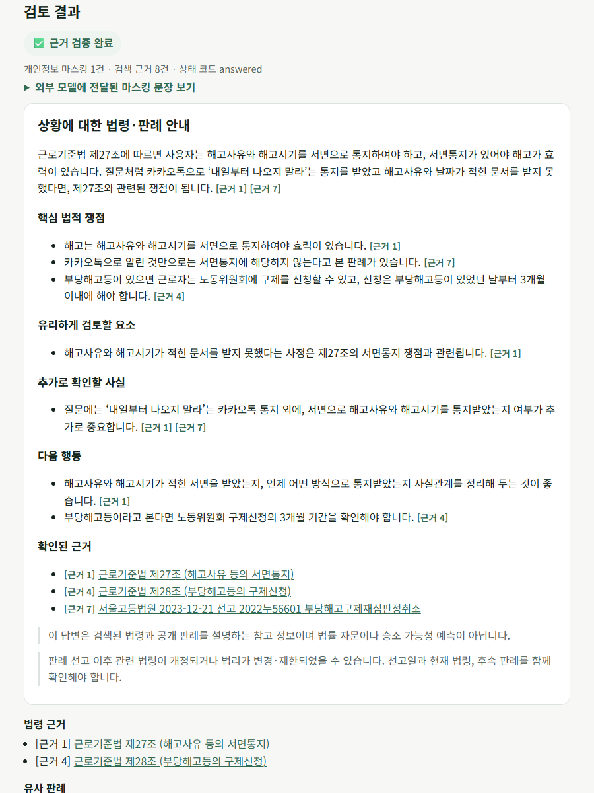

# HTML·CSS·JavaScript 화면과 API (심화 F2013)

Streamlit과 별도로, 화면(`src/legal_rag/web/static/`의 HTML·CSS·JS)과 서버(FastAPI)를 분리한 웹 화면을 제공한다. 서버는 Streamlit과 같은 개인정보 마스킹, LangGraph `retrieve → generate` 파이프라인, 쟁점 체크리스트를 재사용한다.



## 실행

```powershell
python -m pip install -e ".[web]"
uvicorn legal_rag.web.api:app --port 8000
```

브라우저에서 `http://localhost:8000`을 연다. `.env`의 `GMS_KEY`와 법령 색인이 필요하다.

## 요청·응답 형식

### `GET /api/status`

화면이 처음 열릴 때 준비 상태와 분야 목록을 받는다.

```json
{
  "ready": true,
  "message": "GMS와 법령 색인을 사용할 수 있습니다.",
  "categories": [
    {"value": "labor", "label": "근로계약·부당해고", "examples": ["..."]}
  ]
}
```

### `POST /api/review`

요청:

| 필드 | 형식 | 설명 |
|---|---|---|
| `category` | `labor` \| `housing_lease` \| `inheritance` | 상담 분야 |
| `question` | 문자열, 1~2,000자 | 상황 설명. 서버가 외부 호출 전에 마스킹한다 |
| `extra_terms` | 문자열 배열, 최대 20개 | 추가로 가릴 이름·회사명 |
| `include_checklist` | 불리언, 기본 `true` | 쟁점 체크리스트 생성 여부 |

```json
{"category": "labor", "question": "팀장이 카카오톡으로 해고를 알렸어요", "extra_terms": ["홍길동"], "include_checklist": true}
```

응답 `200`:

| 필드 | 설명 |
|---|---|
| `status` | `answered`, `no_evidence`, `insufficient_evidence`, `invalid_citations`, `generation_failed` |
| `status_label`, `status_icon` | 화면 표시용 상태 문구 |
| `answered` | 검증된 답변이면 `true` |
| `content` | 답변 Markdown. 검증 실패 시 고정 안내 문구 |
| `redaction_count`, `sanitized_question` | 마스킹 건수와 외부 모델에 전달한 마스킹 문장 |
| `retrieved_count` | 검색 근거 수 |
| `sources[]` | 답변에 실제 인용된 근거: `citation_id`, `kind`(`statute`/`case`), `label`, `url` |
| `checklist` | `null` 또는 `status`, `message`, `items[]`(`status`, `icon`, `label`, `text`, `citations`, `check_question`, `quotes`), `sources[]`, `dropped_count` |

오류 응답은 모두 `{"error": "고정 안내 문구"}` 형식이다.

| 코드 | 상황 |
|---|---|
| `422` | 분야가 없거나 질문이 비었거나 2,000자를 넘음. 입력값을 되돌려 보내지 않는다 |
| `503` | `GMS_KEY` 누락, 색인 없음 |
| `500` | 그 밖의 처리 실패. 원인은 서버 로그에만 남긴다 |

## 화면 동작

- 분야를 고르면 질문 예시가 나타나고, 예시를 누르면 입력창에 채워진다.
- 제출 중에는 버튼을 비활성화하고 진행 문구를 `aria-live` 영역에 표시한다.
- 답변 Markdown은 HTML을 먼저 이스케이프한 뒤 제목·목록·인용·`[근거 N]`만 변환한다. 링크는 국가법령정보센터(`law.go.kr`) 주소만 허용한다.
- 근거는 `법령 근거`와 `유사 판례`로 나눠 보여 주고, 체크리스트 항목을 체크하면 진행률이 갱신된다.
- API 문서 화면(`/docs`)은 노출하지 않는다.
